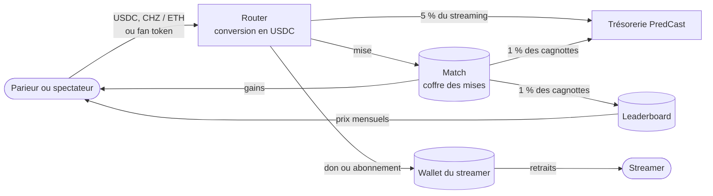
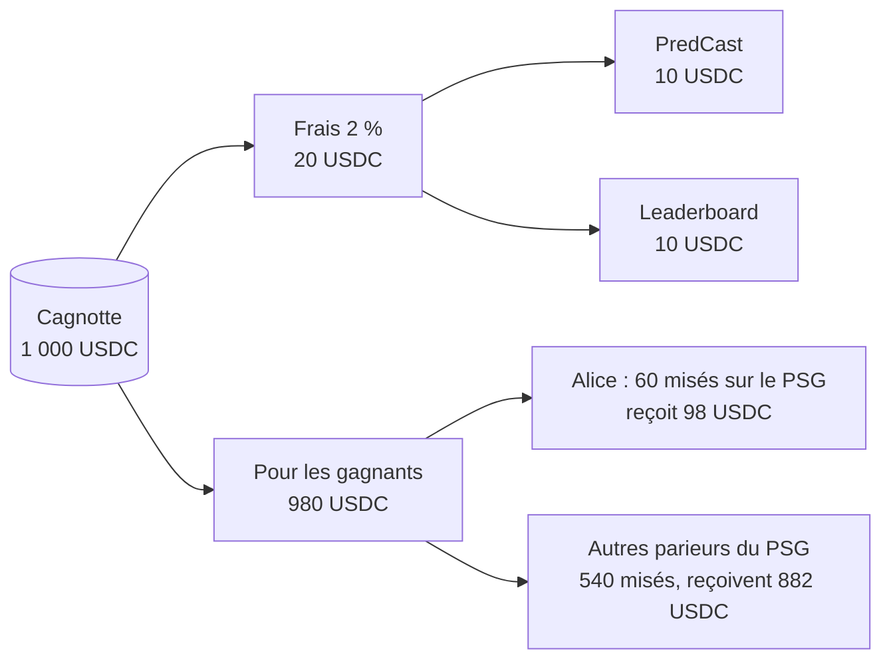
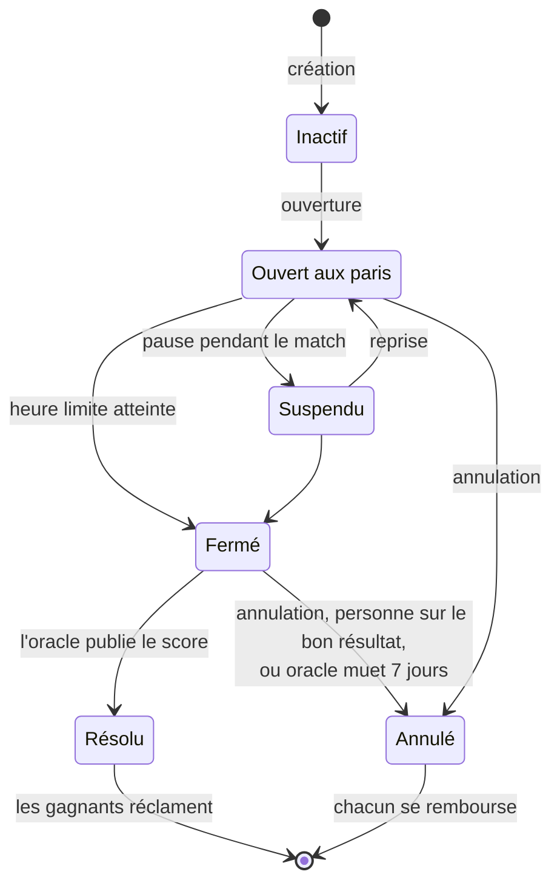
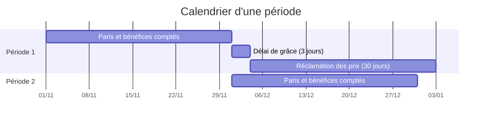
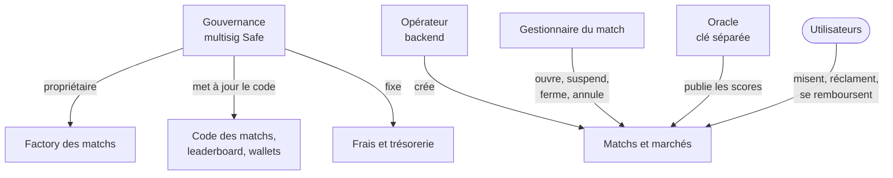

# Vue d'ensemble des smart contracts

> Ce que font les contrats PredCast, où va l'argent et qui contrôle quoi. Pour toute l'équipe, sans prérequis technique.

## En une page

PredCast utilise des smart contracts pour trois choses :

| Brique | Ce qu'elle fait | Pour qui |
|---|---|---|
| **Paris pari-mutuel** | Les mises sur une même question sont mises en commun, les gagnants se partagent la cagnotte | Parieurs |
| **Streaming** | Dons et abonnements payés aux streamers | Spectateurs, streamers |
| **Leaderboard** | Une part des frais de paris est redistribuée chaque mois aux parieurs les plus rentables | Parieurs |

Tout se règle en **USDC**, un dollar numérique (1 USDC ≈ 1 $). L'utilisateur peut payer :

- en USDC directement ;
- avec le token natif du réseau : CHZ sur Chiliz, ETH sur Base ;
- avec un fan token (PSG, BAR, CITY…).

Dans les deux derniers cas, un contrat appelé **router** convertit le paiement en USDC sur un échange décentralisé, puis le dépose au bon endroit.

| Réseau | Statut au 11/11/2026 |
|---|---|
| **Chiliz** | En production. La [PR #43](https://github.com/PredCast/predcast.tv/pull/43) apporte une nouvelle version, qui reste à déployer |
| **Base** | Code prêt et testé sur des copies du réseau. Pas encore déployé, sujet traité plus tard |

## Comment marche un pari pari-mutuel

Il n'y a pas de bookmaker et pas de cote fixée à l'avance. Toutes les mises sur une même question vont dans une cagnotte commune. Quand le résultat est connu, les gagnants se partagent cette cagnotte, moins les frais, au prorata de leur mise.

**Exemple.** Marché « Vainqueur » du match PSG – OM :

| Issue | Total misé |
|---|---|
| PSG gagne | 600 USDC |
| Match nul | 150 USDC |
| OM gagne | 250 USDC |
| **Cagnotte** | **1 000 USDC** |

Le PSG gagne :

1. Les frais de 2 % sont prélevés : 20 USDC, dont 10 pour PredCast et 10 pour le leaderboard.
2. Il reste 980 USDC pour les gagnants.
3. Alice avait misé 60 USDC sur le PSG. Elle reçoit 60 × 980 / 600 = **98 USDC**, soit 38 USDC de gain.

La « cote » n'est connue qu'à la fermeture du marché : ici, 980 / 600 ≈ 1,63. Avant, l'application peut afficher une cote estimée à partir des mises en cours.

**Cas particuliers**

| Situation | Ce qui se passe |
|---|---|
| Personne n'a misé sur le bon résultat | Le marché est annulé, chacun récupère toute sa mise, aucun frais |
| Tout le monde a misé sur le bon résultat | Aucun frais, chacun récupère sa mise |
| Le résultat ne vient jamais (oracle en panne) | 7 jours après l'heure limite, n'importe qui peut annuler le marché, puis chacun se fait rembourser |
| Mise trop petite | Minimum 0,01 USDC |
| Restes d'arrondis | Quelques centimes peuvent rester une fois tout le monde payé. N'importe qui peut les envoyer à la trésorerie |

**Les frais.** 2 % par défaut, partagés à parts égales entre PredCast et le leaderboard. Ils ne peuvent jamais dépasser 5 %. Le taux d'un marché est figé à son ouverture : un changement ne touche que les marchés ouverts ensuite.

## Les marchés proposés

Un **match** est un événement réel. Un **marché** est une question sur ce match. Un match peut porter autant de marchés que l'on veut, chacun avec sa propre cagnotte.

| Football | Issues possibles |
|---|---|
| Vainqueur (à 90 minutes) | Domicile / Nul / Extérieur |
| Plus ou moins de buts | Moins / Plus que la ligne (ex. 2,5) |
| Les deux équipes marquent | Non / Oui |
| Vainqueur à la mi-temps | Domicile / Nul / Extérieur |
| Score exact | Un score de 0-0 à 9-9 |
| Premier buteur | Un joueur |
| Nombre exact de buts | 0, 1, 2… jusqu'à un plafond |
| Double chance | 1X, 12 ou X2 |
| Vainqueur final (élimination directe) | Domicile / Extérieur, prolongation et tirs au but compris |

| Basketball | Issues possibles |
|---|---|
| Vainqueur (prolongation comprise) | Domicile / Extérieur |
| Total de points | Moins / Plus que la ligne |
| Handicap | L'équipe à domicile couvre ou non |
| Vainqueur d'un quart-temps | Domicile / Extérieur |
| Première équipe à marquer | Domicile / Extérieur |
| Quart-temps le plus prolifique | Q1 / Q2 / Q3 / Q4 |
| Nombre exact de points | Par tranches (ex. 0-19, 20-39…) |

## La vie d'un marché

| Étape | Qui | Comment |
|---|---|---|
| Créer le match et ses marchés | Le backend (opérateur) | Une seule transaction crée le match, ajoute les marchés, fixe l'heure limite et les ouvre |
| Suspendre ou rouvrir | Le gestionnaire du match | Par exemple pendant un incident de jeu |
| Fermer | N'importe qui après l'heure limite | Après l'heure limite, toute nouvelle mise est refusée de toute façon |
| Résoudre | L'oracle (clé dédiée du backend) | Il envoie le score, le contrat en déduit le résultat de chaque marché |
| Réclamer ses gains | Chaque gagnant | Les gains sont versés en USDC |
| Se faire rembourser | Chaque parieur d'un marché annulé | Toute la mise est rendue |

> Une résolution est définitive : le contrat ne permet pas de corriger un score publié. L'oracle doit vérifier avant d'envoyer.

## Le leaderboard

Chaque résolution de marché envoie 1 % de la cagnotte au leaderboard. Ces fonds sont redistribués par **périodes de 30 jours**.

- **Le score** d'un parieur sur une période est son **bénéfice net** : ce qu'il a gagné moins ce qu'il avait misé sur ces marchés. Miser sur toutes les issues pour gonfler son score ne rapporte rien.
- **La répartition** est proportionnelle : un parieur qui a fait 30 % des bénéfices de la période reçoit 30 % de la cagnotte du leaderboard.
- **La fenêtre de réclamation** dure 30 jours après la clôture de la période. Le temps passé en pause est ajouté à ce délai.
- **Les prix non réclamés** retournent dans la cagnotte suivante.

**Exemple.** La cagnotte de la période est de 300 USDC. Alice a fait 600 USDC de bénéfice, Bob 300 et Carol 100, soit 1 000 au total. Alice reçoit 180 USDC, Bob 90 et Carol 30.

Un bénéfice compte quand le gagnant **réclame** ses gains, pour la période où le marché a été résolu. Le délai de grâce de 3 jours laisse aux gagnants des derniers matchs le temps de le faire avant la clôture. Un gain réclamé après la clôture de sa période est payé normalement, mais ne compte plus pour le leaderboard. L'application peut le rappeler aux parieurs.

## Le streaming

Chaque streamer a son propre **wallet** : un contrat qui garde ses revenus en USDC jusqu'à ce qu'il les retire.

| Action | Qui | Détail |
|---|---|---|
| Faire un don | Un spectateur | En USDC, CHZ / ETH ou fan token, avec un message |
| S'abonner | Un spectateur | Prix et durée fixés par le streamer (entre 1 et 365 jours). Se réabonner prolonge l'abonnement |
| Fixer son prix | Le streamer | Par exemple 5 USDC pour 30 jours |
| Retirer ses revenus | Le streamer | À tout moment, vers son adresse ou une adresse de versement |

PredCast prend **5 % de frais** sur chaque don et abonnement, envoyés à la trésorerie. Seule la gouvernance peut changer ce taux.

**Exemple.** Un don de 10 USDC envoie 0,50 USDC à la trésorerie et 9,50 USDC au wallet du streamer.

## Chiliz et Base

Le même code tourne sur les deux réseaux. Seul le paiement d'entrée change.

| | Chiliz | Base |
|---|---|---|
| Token natif | CHZ | ETH |
| Échange utilisé pour convertir | Kayen | Aero (ex-Aerodrome) |
| Fan tokens | Beaucoup, mais avec très peu de liquidité | CHZ, PSG, AFC, PEPPER seulement |
| Statut | En production | À déployer plus tard |

> **Payer en fan token coûte cher au parieur.** Les réserves des échanges sont petites : un gros paiement en fan token fait chuter le prix et le parieur mise moins que prévu. Payer en USDC ou en ETH est presque gratuit. L'application doit privilégier ces deux moyens et afficher la perte avant validation. Voir le document Base pour les chiffres.

## Qui contrôle quoi

- **Personne ne peut retirer directement les mises des parieurs.** Les admins peuvent annuler un marché, ce qui rembourse tout le monde, mais pas prendre les fonds.
- **La gouvernance peut mettre à jour le code**, donc changer les règles. C'est pour cela qu'elle doit être un multisig (Safe) : plusieurs personnes doivent signer.
- **L'oracle est la seule clé qui publie les résultats.** Elle doit être distincte de toutes les autres.

Le détail des rôles et des procédures est dans le document « Exploitation et sécurité ».

## Où en est la sécurité

| Vérification | État |
|---|---|
| Tests automatisés | 335 tests, plus 18 sur une copie du réseau Base. Tous passent |
| Tests de propriétés | 18 règles vérifiées sur plus de 2 millions d'appels aléatoires (« l'argent est toujours couvert », « personne n'est payé deux fois »…) |
| Couverture du code par les tests | Environ 90 % des lignes |
| Analyse automatique (Slither, Aderyn) | Aucun problème réel ouvert |
| Revue indépendante du code | Faite, les problèmes trouvés sont corrigés et testés |
| Compatibilité avec les contrats en production sur Chiliz | Prouvée sur une copie du réseau |
| **Audit externe** | **Pas encore fait. Recommandé avant de gérer des montants importants** |

## Glossaire

| Terme | Définition |
|---|---|
| **USDC** | Stablecoin qui vaut 1 dollar. Toutes les mises et tous les gains sont en USDC |
| **Pari-mutuel** | Système où les mises sont mises en commun et partagées entre les gagnants |
| **Marché** | Une question sur un match, avec ses issues possibles |
| **Oracle** | Le service qui publie les résultats sur la blockchain |
| **Router** | Le contrat qui convertit les paiements en USDC et les dépose au bon endroit |
| **Liquidité** | Les réserves d'un échange. Peu de liquidité signifie qu'un gros échange fait bouger le prix |
| **Slippage** | L'écart entre le prix affiché et le prix obtenu lors d'un échange |
| **Fan token** | Token d'un club (PSG, BAR…) |
| **Safe** | Portefeuille multisig : une action demande la signature de plusieurs personnes |
| **Mise à jour (upgrade)** | Remplacement du code d'un contrat sans changer son adresse ni perdre ses fonds |
| **Période (epoch)** | Cycle de 30 jours du leaderboard |
