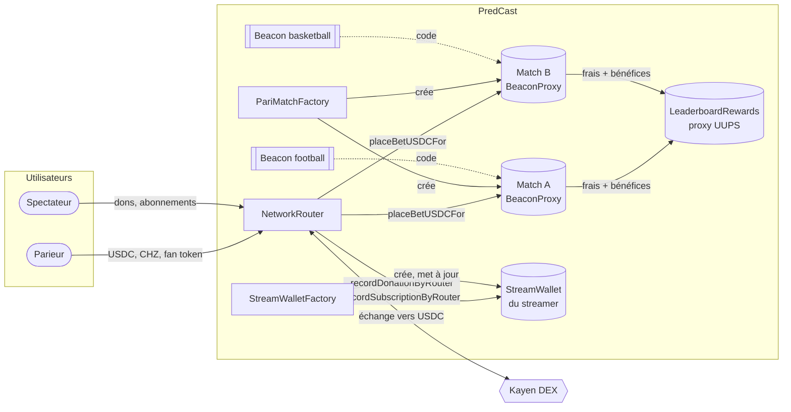
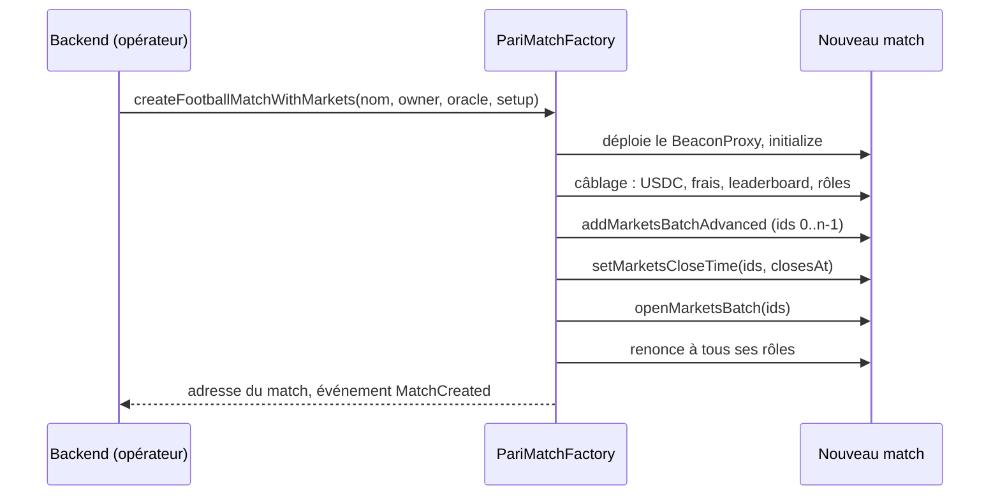
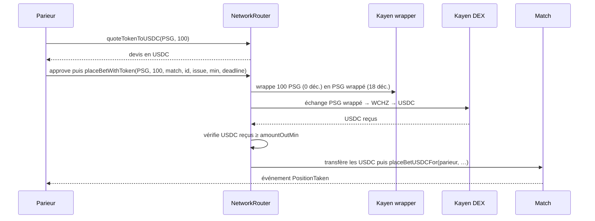
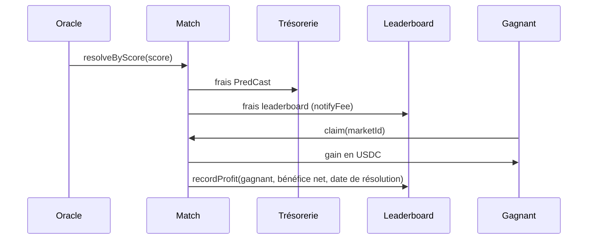

# Guide développeur : Chiliz

> Adresses, appels à faire pour chaque scénario, événements, erreurs et ce que change la PR #43. Pour les développeurs frontend, backend et contrats.

## À savoir avant de commencer

1. **Deux versions coexistent.** Les contrats en production sur Chiliz sont une version antérieure à la [PR #43](https://github.com/PredCast/predcast.tv/pull/43). Leurs noms de fonctions diffèrent, voir « Ce qui est en prod » ci-dessous. Ce guide décrit la version de la PR, sauf mention contraire.
2. **Tout est en USDC, 6 décimales.** 1 USDC = `1_000_000`.
3. **Les mises passent uniquement par le router.** L'utilisateur approuve un seul contrat, le router, et jamais les matchs.
4. **Toujours demander un devis au router** avant un paiement en CHZ ou en fan token, et passer un minimum (`amountOutMin`) calculé à partir du **prix de marché**, pas seulement du devis. Voir la section sur les paris.
5. **Les fan tokens Chiliz ont 0 décimale.** 100 PSG s'écrit `100`. Le router les « wrappe » (version à 18 décimales) avant l'échange sur Kayen.
6. **`evm_version` doit rester `shanghai`.** Chiliz ne supporte pas les opcodes plus récents.

Référence complète des fonctions, générée depuis le code : `docs/reference/` (dans le dépôt). Les scénarios ci-dessous reprennent `docs/CALL_FLOWS.md`.

## Adresses

### Contrats PredCast en production

| Contrat | Chiliz mainnet (88888) | Spicy testnet (88882) |
|---|---|---|
| Factory des matchs | `0x1e7F73d14D3E87205A766A14eC5847C12FEBfFd7` | `0x5c6433b9a03feb15e1e6cd0745a3013cea4879ac` |
| Router (`ChilizSwapRouter`) | `0x72befD1186f24Cba64266995cD627B79C799292a` | `0xed417f0b94455e114e05a1ce54c0fdb858fe21ad` |
| Factory des wallets streamers | `0x0Ffa30b48ADc0b2B773DC01422D249aEE135a4Bb` | `0xeb92b6620556cbbc0bdb57371c501b1794961fd3` |
| Leaderboard (proxy) | `0x3210326343f4C682FF3D9d29727BB61785deF55b` | `0x1d12428243f842de0449ed6f3e8ae6dce03ace14` |

Source de vérité : `deployments/chilizMainnet.json` et `deployments/chilizTestnet.json`.

### Infrastructure Chiliz mainnet

| Contrat | Adresse |
|---|---|
| USDC (6 décimales) | `0xa37936F56249965d407E39347528a1A91eB1cbef` |
| WCHZ | `0x677F7e16C7Dd57be1D4C8aD1244883214953DC47` |
| Kayen router V2 | `0x1918EbB39492C8b98865c5E53219c3f1AE79e76F` |
| Kayen wrapper factory (fan tokens) | `0xAEdcF2bf41891777c5F638A098bbdE1eDBa7B264` |
| Pool WCHZ/USDC | `0xFf6D22b9Bd32afb60aC717248c77bE1ea16107a5` |

La liste des fan tokens et de leurs pools est dans `docs/FAN_TOKENS_MAINNET.md` et `docs/TEST_ADDRESSES.md`.

> Ne jamais copier une adresse de token d'un réseau à l'autre : `0xDD15…7EC8` est PERSIB sur Chiliz et PSG sur Base.

## Ce qui est en prod et ce que change la PR #43

| Sujet | En production aujourd'hui | Après déploiement de la PR |
|---|---|---|
| Matchs | Un proxy UUPS par match, mis à jour match par match (58 matchs existants) | Un BeaconProxy par match : une mise à jour par sport touche tous les matchs d'un coup. **Nouvelle factory à déployer** |
| Router | `ChilizSwapRouter` : `placeBetWithCHZ`, `donateWithCHZ`, `subscribeWithCHZ`, `wchz()` | `NetworkRouter` : `placeBetWithNativeToken`, `donateWithNativeToken`, `subscribeWithNativeToken`, `wrappedNativeToken()`. **Nouveau déploiement** |
| Mise en USDC | `match.placeBetUSDC` direct, ou via le router | **Uniquement** `router.placeBetWithUSDC`. `placeBetUSDC` n'existe plus |
| Création d'un match | 4 transactions | `factory.createFootballMatchWithMarkets` : 1 transaction, environ 11 % de gas en moins |
| Heure limite des paris | Aucune on-chain : il faut fermer le marché à temps | `closesAt` par marché : toute mise après est refusée, n'importe qui peut fermer |
| Oracle en panne | Fonds bloqués jusqu'à une action admin | `cancelStaleMarket` par n'importe qui, 7 jours après `closesAt` |
| Partage des frais (2 % au total) | 1 % PredCast, 1 % leaderboard | 1,5 % PredCast, 0,5 % leaderboard pour les nouveaux matchs. Applicable dès maintenant à la prod, voir plus bas |
| Arrondis des gains | Chaque gain arrondi vers le bas : quelques unités restent dans le match | Gains arrondis sur le cumul : le dernier gagnant vide la cagnotte, rien ne reste |
| Leaderboard | V2 | V5, mis à jour **sur place** (même adresse) : score = bénéfice net, `claimDeadline` prolongé par les pauses, prix arrondis sur le cumul |
| Wallets streamers | Version actuelle | Mis à jour **sur place** via la factory des wallets |
| Oracle | Aucune règle : l'oracle peut être la clé admin | Clé séparée obligatoire (`RESOLVER_ROLE`), refusée si identique au propriétaire ou à l'opérateur |

Les noms des événements du router changent aussi : `BetPlacedViaCHZ` → `BetPlacedViaNativeToken`, `DonationWithCHZ` → `DonationWithNativeToken`, `SubscriptionWithCHZ` → `SubscriptionWithNativeToken`. Les sélecteurs et les topics changent avec : l'indexeur et le frontend doivent basculer en même temps que le déploiement.

## Architecture



| Contrat | Fichier | Rôle |
|---|---|---|
| `PariMatchBase` | `src/pari/PariMatchBase.sol` | Coffre USDC, cycle de vie des marchés, calcul pari-mutuel |
| `FootballPariMatch`, `BasketballPariMatch` | `src/pari/` | Types de marchés et résolution par score |
| `PariMatchFactory` | `src/pari/PariMatchFactory.sol` | Crée les matchs (BeaconProxy), une beacon par sport, tient la liste `isMatch` |
| `NetworkRouter` | `src/swap/NetworkRouter.sol` | Échange vers USDC, livre les mises, dons et abonnements |
| `StreamWallet` | `src/streamer/StreamWallet.sol` | Coffre USDC d'un streamer |
| `StreamWalletFactory` | `src/streamer/StreamWalletFactory.sol` | Crée et met à jour les wallets, tient leur configuration |
| `LeaderboardRewards` | `src/leaderboard/LeaderboardRewards.sol` | Cagnotte par période de 30 jours, répartie au prorata du bénéfice net |

## Créer un match

L'opérateur (clé du backend, `matchOperator`) ou le propriétaire de la factory fait **un seul appel** :

```solidity
factory.createFootballMatchWithMarkets(
    "PSG vs OM",          // nom
    owner,                // gestionnaire du match : ADMIN_ROLE + PAUSER_ROLE
    oracle,               // RESOLVER_ROLE, doit être une clé distincte
    MarketSetup({
        marketTypes: [keccak256("WINNER"), keccak256("GOALS_TOTAL"), keccak256("BOTH_SCORE")],
        lines:       [int16(0), 25, 0],   // 25 = 2,5 buts
        extras:      [uint8(0), 0, 0],    // quart-temps ou pas des tranches au basket, sinon 0
        groupIds:    [uint16(0), 0, 0],   // regroupement libre pour l'interface
        closesAt:    kickoff,             // timestamp du coup d'envoi, 0 = pas d'heure limite
        open:        true                 // ouvre les marchés tout de suite
    })
);
```



- Les marchés reçoivent les ids `0` à `n-1` dans l'ordre du tableau.
- `basketball` : `createBasketballMatchWithMarkets`, même structure.
- Les types de marchés et l'encodage des issues sont dans `docs/PARI_MUTUEL.md`. Le type se lit aussi on-chain : `match.MARKET_WINNER()`.
- La version en 4 étapes existe toujours (`createFootballMatch`, puis `addMarketWithLine`, `setMarketCloseTime`, `openMarket`), par exemple pour ajouter un marché plus tard.
- L'ouverture fige les frais du marché.

## Parier

Le marché doit être ouvert et avant son `closesAt`. Mise minimale : 0,01 USDC. Un utilisateur peut miser plusieurs fois, sur plusieurs issues.

| Paiement | Appels |
|---|---|
| USDC | `usdc.approve(router, amount)` puis `router.placeBetWithUSDC(match, marketId, outcome, amount)` |
| CHZ | `router.quoteTokenToUSDC(router.wrappedNativeToken(), value)` puis `router.placeBetWithNativeToken{value}(match, marketId, outcome, amountOutMin, deadline)` |
| Fan token | `router.quoteTokenToUSDC(token, amount)`, `token.approve(router, amount)`, puis `router.placeBetWithToken(token, amount, match, marketId, outcome, amountOutMin, deadline)` |



**Règles pour le frontend**

- **Devis.** Toujours via `router.quoteTokenToUSDC`, pour que la route devisée soit celle exécutée. Un devis de 0 veut dire qu'il n'y a pas de route : ne pas envoyer.
- **`amountOutMin`.** Ne peut pas être 0. Le calculer à partir du **prix de marché** du token (une source externe), moins la tolérance, par exemple 1 %. Le contrat refusera alors tout pari qui ferait perdre plus que ça au parieur. Un minimum basé uniquement sur le devis protège contre un mouvement entre le devis et l'exécution, pas contre une pool trop petite.
- **Afficher la perte.** Montrer « vous misez X USDC » avant validation, et avertir quand l'écart avec la valeur au prix de marché dépasse 1 %. Les pools Kayen sont petites : environ 43 000 USDC sur WCHZ/USDC, et quelques milliers de CHZ seulement pour la plupart des fan tokens.
- **`deadline`.** Timestamp en secondes, quelques minutes après l'envoi.
- **Ne jamais envoyer de tokens directement au router.** Toujours `approve`, puis appeler.

Événements : le match émet toujours `PositionTaken`. Le router émet en plus `BetPlacedWithUSDC`, `BetPlacedViaNativeToken` ou `BetPlacedViaToken`, et `FanTokenWrapped` quand il wrappe un fan token.

## Fermer et résoudre

| # | Qui | Appel |
|---|---|---|
| 1 | N'importe qui, après `closesAt` | `match.closeExpiredMarket(marketId)` |
| 1 bis | Le gestionnaire du match | `match.closeMarket(marketId)` ou `closeMarketsBatch(ids)` |
| 2 | L'oracle | `match.resolveByScore(score)` au football, `match.resolveByFinalScore(score)` au basket |

```solidity
struct FootballScore {
    uint8 homeGoals;     uint8 awayGoals;      // à 90 minutes
    uint8 htHomeGoals;   uint8 htAwayGoals;    // mi-temps
    uint8 firstScorerId;                       // 0 = inconnu
    uint8 aetHomeGoals;  uint8 aetAwayGoals;   // après prolongation, sinon = score à 90 min
    uint8 penWinner;                           // 0 domicile, 1 extérieur, 255 pas de tirs au but
}
```

- Un seul appel résout tous les marchés fermés du match qu'on peut déduire du score.
- **Un marché qu'on ne peut pas déduire reste fermé, sans erreur** : premier buteur inconnu, égalité sur un quart-temps, handicap pile sur la ligne, etc. On le résout ensuite avec `resolveMarket(id, issue)` ou on l'annule avec `cancelMarket(id, raison)`.
- `computeOutcome(marketId, score)` (et `computeOutcomeFinal` au basket) donne le résultat sans rien écrire : utile pour vérifier avant d'envoyer.
- À la résolution, les frais partent vers la trésorerie et le leaderboard (événements `MarketResolved`, `FeeNotified` côté leaderboard).
- Personne sur la bonne issue : le marché passe en Annulé et tout le monde se rembourse.

> La résolution est définitive. Il n'existe aucune fonction pour corriger un résultat publié.

## Réclamer et se faire rembourser

| Situation | Qui | Appel |
|---|---|---|
| Marché résolu, l'utilisateur a gagné | Utilisateur | `match.claim(marketId)` |
| Plusieurs marchés | Utilisateur | `match.claimBatch(ids)` : ignore ce qui n'est pas réclamable |
| Marché annulé | Utilisateur | `match.claimRefund(marketId)` ou `claimRefundBatch(ids)` |
| Oracle muet | N'importe qui, après `match.staleAt(marketId)` | `match.cancelStaleMarket(marketId)`, puis remboursements |

- Gain = mise sur l'issue gagnante × `resolvedNetPool` / total misé sur l'issue gagnante, arrondi sur le cumul : le contrat verse `floor((mise déjà réclamée + mise) × resolvedNetPool / total gagnant)` moins ce qu'il a déjà versé. La somme des gains égale `resolvedNetPool` à l'unité près, et chaque gain est la part exacte arrondie vers le bas ou vers le haut.
- Pour afficher un gain avant la réclamation, la formule simple suffit : elle peut différer d'une unité (0,000001 USDC) de ce qui sera versé.
- Les gains sont versés en USDC, sans échange en sortie.
- `claim` enregistre aussi le bénéfice net du gagnant dans le leaderboard (`recordProfit`).
- Une pause bloque les réclamations 7 jours au maximum. Les remboursements restent possibles pendant une pause.



## Leaderboard

| Action | Qui | Appel |
|---|---|---|
| Lire la période en cours | N'importe qui | `currentEpoch()`, `epochScore(id, user)`, `openPrizePool()` |
| Clôturer la période | N'importe qui, après `nextCloseTime()` | `advanceEpoch()` |
| Voir un prix | N'importe qui | `pendingClaim(id, user)` |
| Réclamer | L'utilisateur, avant `claimDeadline(id)` | `claim(id)` |
| Recycler les prix non réclamés | N'importe qui, après `claimDeadline(id)` | `rolloverEpoch(id)` |

> **Frontend : utiliser `claimDeadline(id)`**, pas `epoch(id).claimExpiry`. La date limite est repoussée de la durée des pauses, `claimExpiry` ne l'est pas.

Paramètres : périodes de 30 jours, clôture 3 jours après la fin de période (`SCORING_GRACE`), fenêtre de réclamation de 30 jours à partir de la clôture réelle.

## Streaming

**Préparer un streamer**

1. `streams.getWallet(streamer)` : `address(0)` s'il n'a pas encore de wallet.
2. Le propriétaire de la factory appelle `streams.deployWalletFor(streamer)`. Un premier don crée aussi le wallet.
3. Le streamer appelle `wallet.setSubscriptionPricing(price, period)` : `price` USDC pour `period` secondes, entre 1 et 365 jours.
4. Facultatif : `wallet.setPayoutAddress(adresse)`.

**Payer**

| Action | USDC | CHZ | Fan token |
|---|---|---|---|
| Don | `donateWithUSDC(streamer, message, amount)` | `donateWithNativeToken{value}(streamer, message, min, deadline)` | `donateWithToken(token, amount, streamer, message, min, deadline)` |
| Abonnement | `subscribeWithUSDC(streamer, duration, amount)` | `subscribeWithNativeToken{value}(streamer, duration, min, deadline)` | `subscribeWithToken(token, amount, streamer, duration, min, deadline)` |

- Toujours `approve` le router avant un paiement en USDC ou en token.
- Le prix d'un abonnement se lit avec `wallet.subscriptionCost(duration)`. Il inclut les frais. Sur un paiement avec échange, `amountOutMin` doit être au moins égal à ce prix, sinon le router refuse (`SubscriptionUnderpaid`).
- L'abonnement échoue avec `SubscriptionPriceNotSet` tant que le streamer n'a pas fixé son prix.
- Se réabonner pendant un abonnement actif ajoute la durée à l'échéance.
- Vérifier un accès : `wallet.isSubscribed(user)` ou `wallet.getSubscription(user)`.
- Retrait : le streamer appelle `wallet.withdrawRevenue(amount)`, après avoir lu `wallet.availableBalance()`.
- Frais : `router.platformFeeBps()`, 500 = 5 %, envoyés à `router.treasury()`.

## Événements à indexer

| Contrat | Événements principaux |
|---|---|
| Factory | `MatchCreated(proxy, sportType, owner)` |
| Match | `MarketCreated`, `MarketStateChanged`, `MarketCloseTimeSet`, `MarketFeesFrozen`, `PositionTaken`, `MarketResolved`, `PositionClaimed`, `StakeRefunded`, `MarketCancelled`, `StaleMarketCancelled` |
| Router | `BetPlacedWithUSDC`, `BetPlacedViaNativeToken`, `BetPlacedViaToken`, `DonationWithUSDCEvent`, `DonationWithNativeToken`, `DonationWithToken`, `SubscriptionWithUSDCEvent`, `SubscriptionWithNativeToken`, `SubscriptionWithToken`, `FanTokenWrapped` |
| Wallet streamer | `DonationReceived`, `SubscriptionRecorded`, `RevenueWithdrawn`, `SubscriptionPricingSet` |
| Leaderboard | `FeeNotified`, `WinRecorded`, `EpochAdvanced`, `PrizeClaimed`, `EpochRolledOver`, `ProfitIgnored` |

`LeaderboardRecordFailed` et `LeaderboardNotifyFailed` sur un match signalent que le leaderboard a refusé un appel. Le pari et le paiement passent quand même, mais il faut enquêter.

## Erreurs fréquentes

| Erreur | Signification | Que faire |
|---|---|---|
| `SlippageNotSet` | `amountOutMin` vaut 0 | Demander un devis et passer un minimum |
| `DeadlinePassed` | Le `deadline` est passé | Utiliser un timestamp plus tardif |
| `InsufficientOutput` | L'échange a rapporté moins que `amountOutMin` | Redemander un devis |
| `TokenIsUSDC` | `*WithToken` appelé avec l'USDC | Utiliser `*WithUSDC` |
| `UnauthorizedBettingMatch` | L'adresse n'est pas un match de la factory | Vérifier `factory.isMatch(match)` |
| `InvalidMarketState` | Le marché n'est pas dans le bon état | Lire `match.getMarketInfo(id)` |
| `BettingClosed` | `closesAt` est passé | Ne plus proposer ce marché |
| `StakeBelowMinimum` | Mise inférieure à 0,01 USDC | Miser plus |
| `InvalidOutcomeValue` | Issue hors limites | Lire `maxOutcome` dans `match.getMarketSpec(id)` |
| `NothingToClaim`, `NothingToRefund` | Rien à réclamer ou à rembourser | Rien à faire |
| `AlreadyClaimed` | Déjà réclamé ou remboursé | Rien à faire |
| `ClaimsPaused` | Le match est en pause | Attendre la date indiquée dans l'erreur |
| `SubscriptionPriceNotSet` | Le streamer n'a pas fixé de prix | Le streamer appelle `setSubscriptionPricing` |
| `SubscriptionUnderpaid` | Paiement inférieur au prix de l'abonnement | Payer plus, ou relever `amountOutMin` |

## Ce que la PR change pour le frontend et le backend

| Équipe | À faire au moment du déploiement |
|---|---|
| Frontend | Régénérer les ABI (`artifacts:sync`) une fois les nouveaux contrats déployés. Dans `apps/frontend/scripts/extract-foundry-artifacts.mjs`, `TARGETS` doit passer de `ChilizSwapRouter` à `NetworkRouter` |
| Frontend | Remplacer les appels `*WithCHZ` par `*WithNativeToken` et `wchz()` par `wrappedNativeToken()` |
| Frontend | Supprimer les hooks générés pour `placeBetUSDC` : la fonction n'existe plus sur les matchs |
| Frontend | Lire `claimDeadline(id)` pour le compte à rebours du leaderboard |
| Frontend | Calculer `amountOutMin` à partir du prix de marché et afficher la perte estimée |
| Backend | Créer les matchs avec `createFootballMatchWithMarkets` / `createBasketballMatchWithMarkets` |
| Backend | Une clé oracle séparée (`RESOLVER_PRIVATE_KEY`) pour `resolveByScore`, distincte de la clé admin |
| Indexeur | Nouveaux noms d'événements du router, nouvelles adresses de factory et de router |

Les matchs existants restent sur l'ancienne factory et l'ancien code. Ils continuent de fonctionner avec l'ancien router.

## Environnement de développement

Projet Foundry dans `apps/smart-contracts/chiliz-tv` : Solidity 0.8.24, OpenZeppelin 5, `via_ir`, EVM `shanghai`.

```bash
forge build
forge test
forge test --match-path 'test/invariant/*'
FOUNDRY_PROFILE=deep forge test --match-path 'test/invariant/*'
```

- Une compilation complète prend 10 à 15 minutes à cause de `via_ir`. Pour itérer, `--match-path` sur un fichier.
- Les tests de fork lisent `CHILIZ_RPC_URL` (nœud archive nécessaire, par exemple `https://rpc.ankr.com/chiliz`), `CHILIZ_SPICY_RPC_URL`, `BASE_RPC_URL`, `BASE_SEPOLIA_RPC_URL`. `docs/TEST_ADDRESSES.md` explique comment les lancer sur des forks anvil locaux.
- Répétition complète de la mise en production sur un fork du mainnet Chiliz : `script/anvil/chiliz-mainnet-e2e.sh`, avec anvil en `--auto-impersonate`.
- Après une modification des commentaires NatSpec : `./script/generate-docs.sh` régénère `docs/reference/`.
- Ces guides en PDF : `node docs/guide/build-pdf.mjs`, qui a besoin de Chrome ou Edge.

**Règles pour modifier les contrats**

- Ne jamais changer `evm_version` (`shanghai`) : Chiliz ne connaît pas les opcodes plus récents.
- Le leaderboard et les wallets streamers en production sont mis à jour **sur place**. Toute nouvelle variable de stockage s'ajoute **à la fin**, en réduisant `__gap`. `test/fork/ChilizUpgradeCompatFork.t.sol` vérifie la compatibilité avec les proxys réels.
- Le contrat de match basketball est proche de la limite de taille (environ 1 300 octets de marge). Les nouvelles fonctionnalités de création vont dans la factory.

## Mettre la PR en production sur Chiliz

Deux stratégies possibles, à choisir par l'équipe. Dans les deux cas, les 58 matchs existants restent sur l'ancienne factory et l'ancien router.

| | A. Tout redéployer | B. Garder le leaderboard et les wallets |
|---|---|---|
| Matchs et router | Nouvelle factory, nouveau router | Nouvelle factory, nouveau router |
| Leaderboard | Nouveau contrat, nouvelle adresse | Mis à jour sur place de V2 à V5 (`script/UpgradeLeaderboard.s.sol` avec `MATCH_FACTORY`) |
| Wallets streamers | Nouvelle factory des wallets | Mis à jour sur place (`script/UpgradeStreaming.s.sol`), puis `streams.setSwapRouter(router)` et `router.setStreamWalletFactory(streams)` |
| Outil | `./deploy.sh --network chilizMainnet --all` (`script/DeployAll.s.sol`) | Scripts séparés, plus le câblage à la main |
| Répétition sur fork | Faite (`script/anvil/chiliz-mainnet-e2e.sh`) | La compatibilité du leaderboard et du wallet est prouvée par `test/fork/ChilizUpgradeCompatFork.t.sol`. L'enchaînement complet reste à répéter |
| Ce qu'on perd | L'historique du leaderboard V2 et l'adresse du wallet existant (presque vides aujourd'hui) | Rien |

Dans les deux cas :

1. Simuler d'abord : `--dry-run`, ou le même enchaînement sur un fork anvil du mainnet.
2. Transférer la propriété au Safe (`TRANSFER_OWNERSHIP=true`), puis le Safe appelle `acceptOwnership()` sur chaque contrat.
3. Mettre à jour le frontend, le backend et l'indexeur au même moment (section précédente).

> Gouvernance : le passage au Safe et la clé oracle séparée se font au moment de ce déploiement. Voir « Exploitation et sécurité ».

**Passer la prod actuelle à 1,5 % / 0,5 % sans attendre la PR.** Les contrats en production ont déjà les réglages nécessaires (vérifié on-chain le 12/11/2026 : factory et matchs à 200 / 100) :

1. Pour les futurs matchs, le propriétaire de la factory appelle `factory.setLeaderboardWiring(leaderboard, 50)`.
2. Pour chaque match existant, un compte `DEFAULT_ADMIN_ROLE` appelle `match.setLeaderboardFeeBps(50)`.

Les matchs en production lisent le partage au moment de la résolution, donc le changement touche aussi leurs marchés déjà ouverts. Les parieurs n'y voient aucune différence : le total reste 2 %, seule la répartition entre PredCast et le leaderboard change.
