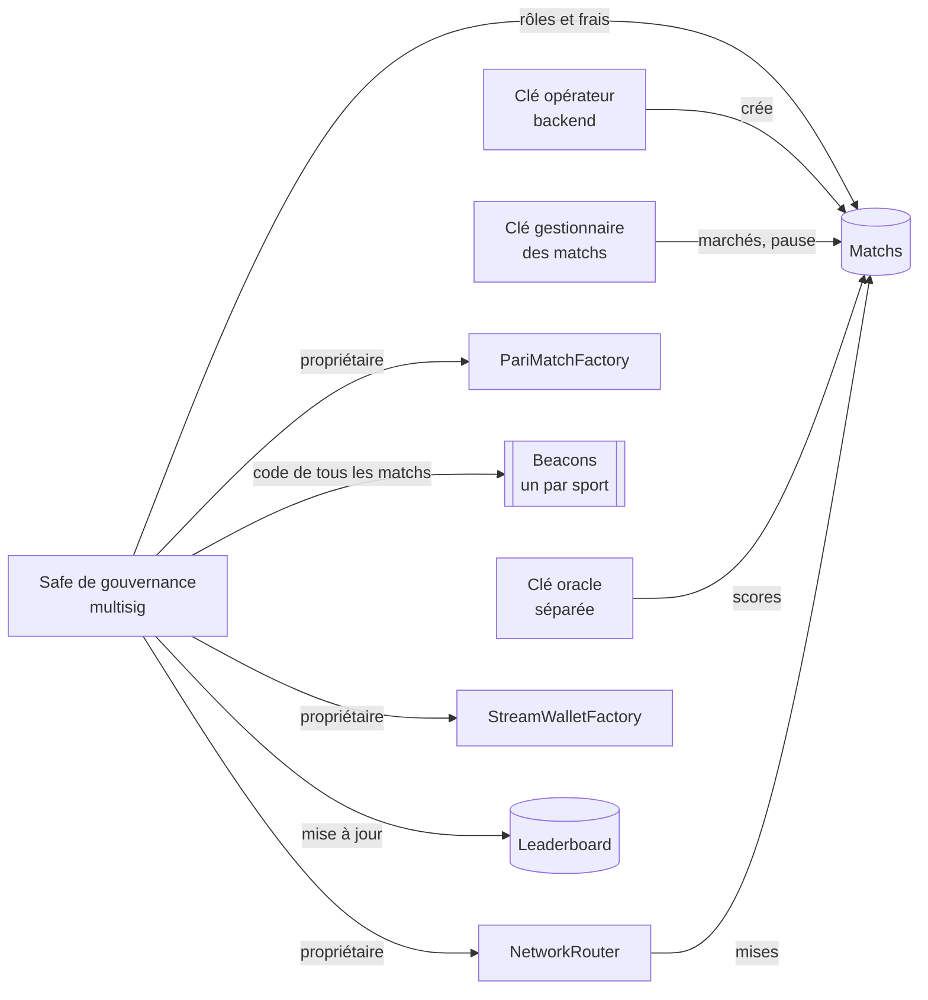
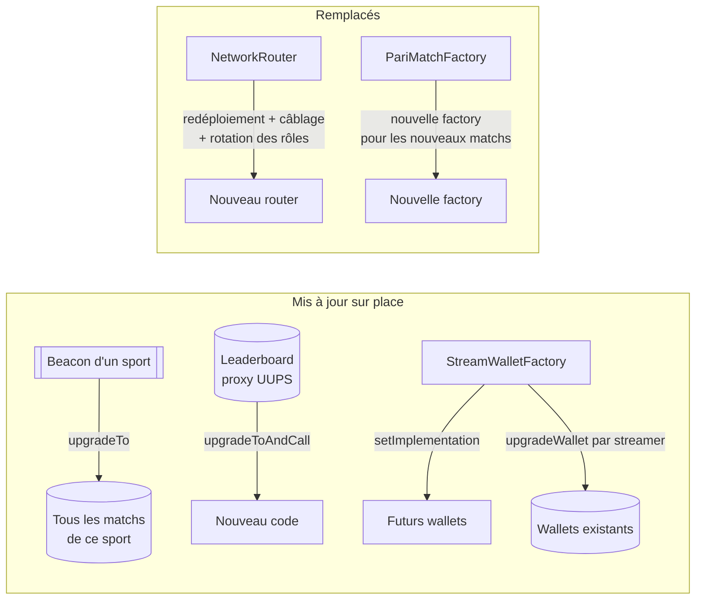

# Exploitation et sécurité

> Qui détient quels pouvoirs, comment gérer les clés, les opérations courantes, les incidents et les mises à jour, et l'état des vérifications de sécurité.

## Les rôles

### Matchs (`FootballPariMatch`, `BasketballPariMatch`)

| Rôle | Détenteur | Pouvoirs |
|---|---|---|
| `DEFAULT_ADMIN_ROLE` | Gouvernance (le `upgradeAdmin` de la factory) | Donner et retirer les rôles, frais et destinataires des frais, token de règlement |
| `ADMIN_ROLE` | Gestionnaire du match (`owner` passé à la création) | Ajouter, ouvrir, suspendre, fermer, annuler des marchés, fixer l'heure limite, lever la pause |
| `PAUSER_ROLE` | Gestionnaire du match | `emergencyPause` |
| `RESOLVER_ROLE` | Oracle | Publier les résultats |
| `SWAP_ROUTER_ROLE` | `NetworkRouter` | Enregistrer une mise pour un utilisateur |

La factory reçoit tous les rôles le temps de la création et y renonce dans la même transaction. Ensuite, elle n'a plus aucun pouvoir sur le match.

### Autres contrats

| Contrat | Détenteur | Pouvoirs |
|---|---|---|
| `PariMatchFactory` | Propriétaire (Safe), transfert en deux étapes | Câblage des nouveaux matchs (`setWiring`, `setLeaderboardWiring`), choix de l'opérateur, création de matchs |
| `PariMatchFactory` | `matchOperator` (backend) | Création de matchs, rien d'autre |
| Beacons (un par sport) | `upgradeAdmin` (Safe) | Changer le code de **tous** les matchs du sport |
| `NetworkRouter` | Propriétaire (Safe), transfert en deux étapes | Frais du streaming (0 à 100 %), trésorerie, factories câblées, wrapper de fan tokens, récupération de tokens égarés |
| `StreamWalletFactory` | Propriétaire (Safe), transfert en deux étapes | Créer un wallet, changer le code des nouveaux wallets, mettre à jour un wallet existant, router câblé |
| `StreamWallet` | Le streamer | Prix de l'abonnement, adresse de versement, retraits |
| `LeaderboardRewards` | `DEFAULT_ADMIN_ROLE` (Safe) | Mise à jour du code, rôles |
| `LeaderboardRewards` | `ADMIN_ROLE` | Durée des périodes (1 à 365 jours), factory de confiance, levée de la pause |
| `LeaderboardRewards` | `PAUSER_ROLE` | `emergencyPause` |
| `ConcentratedPoolAdapter` (Base) | Propriétaire (Safe) | Routes d'échange, récupération de tokens égarés |

## Les clés

| Clé | Type | Utilisée par | Règles |
|---|---|---|---|
| Gouvernance | Safe multisig | L'équipe, plusieurs signataires | Détient tout ce qui change le code, les frais et le câblage |
| Trésorerie | Safe multisig | Finance | Reçoit les frais, n'a aucun pouvoir sur les contrats |
| Opérateur | Clé chaude du backend | Création des matchs | Ne peut que créer des matchs |
| Gestionnaire des matchs | Clé du backend ou Safe opérationnel | Ouverture, fermeture, pause | Ne touche ni au code ni aux frais |
| Oracle | Clé chaude du backend (`RESOLVER_PRIVATE_KEY`) | Résolution | **Distincte de toutes les autres.** Le contrat refuse une clé oracle identique au gestionnaire, au propriétaire de la factory ou à l'opérateur |

**Règles de base**

- Aucune clé privée dans le dépôt : les fichiers `.env` sont ignorés par git, seuls les `.env*.example` sont versionnés.
- Une clé ayant fuité une fois n'est plus jamais réutilisée, sur aucun réseau.
- Des clés différentes pour le testnet et le mainnet.
- Sur le mainnet, les contrats passent au Safe avec `TRANSFER_OWNERSHIP=true`. Le Safe appelle ensuite `acceptOwnership()` sur la factory, le router, la factory des wallets et, sur Base, l'adaptateur.

> **À faire sur Chiliz.** Le passage au Safe, la clé oracle séparée et la rotation des clés sont prévus avec le déploiement de la PR #43.

## Opérations courantes

| Opération | Qui | Appel |
|---|---|---|
| Créer un match avec ses marchés | Opérateur | `factory.createFootballMatchWithMarkets(...)` / `createBasketballMatchWithMarkets(...)` |
| Ajouter un marché à un match existant | Gestionnaire | `match.addMarketWithLine`, puis `setMarketCloseTime` et `openMarket` |
| Suspendre ou reprendre un marché | Gestionnaire | `match.suspendMarket(id)` / `match.openMarket(id)` |
| Annuler un marché | Gestionnaire | `match.cancelMarket(id, raison)` : tout le monde se rembourse |
| Mettre un match en pause | Gestionnaire | `match.emergencyPause()`, puis `match.unpause()` |
| Remplacer l'oracle d'un match | Gouvernance | `match.grantRole(RESOLVER_ROLE, nouvel oracle)` puis `revokeRole(RESOLVER_ROLE, ancien)` |
| Changer l'oracle des futurs matchs | Backend | Utiliser la nouvelle clé dans les appels de création |
| Changer l'opérateur | Gouvernance | `factory.setMatchOperator(nouveau)` |
| Changer les frais des marchés | Gouvernance | `match.setFeeBps` (5 % au plus), `match.setLeaderboardFeeBps`. Seuls les marchés ouverts ensuite sont concernés |
| Changer les frais du streaming | Gouvernance | `router.setPlatformFeeBps` (500 = 5 %) |
| Changer la trésorerie | Gouvernance | `router.setTreasury`, `match.setFeeRecipient`, `factory.setWiring` pour les futurs matchs |
| Clôturer une période du leaderboard | N'importe qui | `leaderboard.advanceEpoch()` |
| Récupérer des tokens envoyés par erreur au router | Gouvernance | `router.rescueTokens(token, destinataire, montant)` |
| Ajouter une route d'échange (Base) | Gouvernance | `adapter.setRoute(token, usdc, pools)` |

`streams.setPlatformFee` et `streams.setTreasury` ne changent que ce que les wallets affichent. Les frais réellement prélevés sont ceux du router.

## Les frais

| Levier | Qui | Défaut | Plafond | Quand il s'applique |
|---|---|---|---|---|
| Frais d'un marché (`feeBps`) | Gouvernance, par match | 2 % | 5 % | Marchés ouverts après le changement |
| Part du leaderboard (`leaderboardFeeBps`) | Gouvernance, par match. `factory.setLeaderboardWiring` pour les futurs matchs | 0,5 % (PredCast garde 1,5 %) | Ne dépasse pas `feeBps` | Marchés ouverts après le changement |
| Frais du streaming (`platformFeeBps`) | Propriétaire du router (Safe) | 5 % | 100 % | Immédiatement |

Les frais d'un marché sont figés à son ouverture : un parieur sait toujours quel taux s'applique à sa mise. Aucun frais n'est prélevé si personne ou tout le monde a misé sur la bonne issue.

Le plafond de 100 % sur le streaming est un choix de l'équipe : seule la gouvernance peut toucher ce levier, et le taux reste à 5 % par défaut.

## Gérer un incident

| Situation | Réaction immédiate | Ensuite |
|---|---|---|
| Comportement anormal d'un match | `match.emergencyPause()` : plus aucune mise, réclamations gelées 7 jours au plus, remboursements toujours possibles | Analyser, annuler les marchés touchés si besoin, puis `unpause()` |
| Oracle en panne | Rien à faire dans l'urgence | Donner `RESOLVER_ROLE` à une clé de secours sur les matchs concernés. Sinon, 7 jours après l'heure limite, n'importe qui peut annuler et chacun se rembourse |
| **Clé oracle compromise** | Retirer `RESOLVER_ROLE` à cette clé **sur chaque match** (un rôle par match : lot de transactions depuis le Safe) | Nouvelle clé oracle, et vérifier les résultats publiés pendant l'incident. Une résolution ne peut pas être corrigée |
| Clé opérateur compromise | `factory.setMatchOperator(nouvelle clé)` | Vérifier les matchs créés pendant l'incident. Le leaderboard fait confiance à tout match de la factory |
| Clé gestionnaire compromise | Retirer `ADMIN_ROLE` et `PAUSER_ROLE` sur les matchs (gouvernance) | La clé ne pouvait pas toucher aux fonds, seulement aux marchés |
| Problème sur le leaderboard | `leaderboard.emergencyPause()` : bloque les réclamations de prix. Le temps de pause est rendu sur les fenêtres de réclamation | `unpause()` après analyse |
| Problème sur le router | Le router n'a pas de pause : mettre en pause les matchs concernés | Déployer un nouveau router (`RedeploySwapRouter.s.sol`), puis transférer `SWAP_ROUTER_ROLE` sur les matchs existants (`RotateSwapRouterRoleOnMatches.s.sol`) |
| Pool d'échange vidée ou manipulée | Le minimum `amountOutMin` protège déjà chaque paiement | Retirer le token de l'interface. Sur Base, changer ou supprimer sa route |
| Tokens envoyés par erreur au router ou à l'adaptateur | `rescueTokens` par le propriétaire | — |

## Mettre à jour le code

| Contrat | Comment | Qui | Script |
|---|---|---|---|
| Matchs | `upgradeTo` sur la beacon du sport : tous les matchs du sport changent d'un coup | `upgradeAdmin` (Safe) | — |
| Leaderboard | Mise à jour UUPS du proxy | `DEFAULT_ADMIN_ROLE` (Safe) | `script/UpgradeLeaderboard.s.sol` |
| Wallets streamers | Nouveau code pour les futurs wallets, puis mise à jour de chaque wallet existant | Propriétaire de la factory des wallets | `script/UpgradeStreaming.s.sol` |
| Router | Nouveau déploiement, câblage, puis rotation de `SWAP_ROUTER_ROLE` sur les matchs existants | Propriétaires | `script/RedeploySwapRouter.s.sol`, `script/RotateSwapRouterRoleOnMatches.s.sol` |
| Factory des matchs | Nouvelle factory : les anciens matchs restent sur l'ancienne | Déployeur, puis Safe | `script/DeployAll.s.sol` |

**Règles pour une mise à jour sur place**

1. Ne jamais déplacer ni supprimer une variable de stockage. Les nouvelles variables s'ajoutent **à la fin**, en réduisant `__gap` d'autant.
2. Lancer `test/fork/ChilizUpgradeCompatFork.t.sol`, qui met à jour les proxys réels de Chiliz sur un fork et compare chaque slot.
3. Répéter la mise à jour sur un fork anvil du réseau cible avant de signer avec le Safe.

## État de la sécurité

### Ce qui a été vérifié

| Vérification | Résultat |
|---|---|
| Tests unitaires et de fork | 341 tests sur Chiliz (EVM shanghai), tous passent. 18 sur un fork du mainnet Base (Cancun), passés le 10/11/2026 |
| Tests de propriétés (invariants) | 18 propriétés, 131 072 appels aléatoires chacune en campagne longue. Toutes tiennent |
| Couverture | Environ 90 % des lignes de code exécutées par les tests |
| Analyse statique | Slither et Aderyn : aucun problème réel ouvert, chaque alerte a été triée |
| Revue indépendante | Faite sur le routage des paiements et l'adaptateur Base. Chaque constat a été confirmé par un test, corrigé et retesté |
| Compatibilité Chiliz | Le leaderboard et le wallet streamer de production ont été mis à jour vers ce code sur un fork : stockage et lectures identiques, contrats fonctionnels |
| Répétitions de déploiement | `DeployAll` et un test complet de paris et de streaming sur des forks du mainnet Chiliz, de Base Sepolia et du mainnet Base |

**Les propriétés vérifiées en continu**, en clair :

- Un match détient toujours au moins ce qu'il doit à ses parieurs, et sa comptabilité interne égale la somme de ses marchés.
- L'argent est conservé : rien n'entre ni ne sort sans être compté.
- Un gagnant ne touche jamais plus que sa part, et personne n'est payé deux fois.
- Chaque gain est la part exacte à un millionième d'USDC près, et une fois tous les gagnants payés il ne reste rien dans le match. Même règle pour les prix du leaderboard.
- Le router ne garde jamais l'argent des utilisateurs.
- Le leaderboard détient toujours au moins les prix qu'il doit encore.
- Le solde d'un wallet streamer égale ses paiements nets moins ses retraits, et la trésorerie reçoit exactement les frais prévus.
- Les fonctions qui doivent réussir réussissent, et celles qui doivent échouer échouent.

### Hypothèses de confiance

Ce sont des choix assumés. Un auditeur les verra comme des points d'attention.

| Point | Pourquoi c'est accepté |
|---|---|
| L'oracle est de confiance et sa résolution est définitive | Le score vient du backend. La clé est séparée, et un marché sans résultat s'annule au bout de 7 jours |
| La gouvernance peut mettre à jour le code, sans délai (pas de timelock) | Choix fait au lancement. La gouvernance doit être un Safe multisig |
| Les frais du streaming peuvent aller jusqu'à 100 % | Décision de l'équipe : levier réservé à la gouvernance, 5 % par défaut |
| Le leaderboard et le router font confiance à tout match créé par la factory | Seuls l'opérateur et le propriétaire de la factory peuvent créer un match : ces clés doivent être protégées |
| L'ancien format de stockage est conservé | Nécessaire pour mettre à jour sur place les contrats de production sur Chiliz. Prouvé par le test de fork |
| Sur Base, le propriétaire de l'adaptateur choisit les pools d'échange | Le minimum `amountOutMin` de chaque paiement borne la perte possible |

### Ce qui reste à faire

1. **Audit externe** avant de gérer des montants importants.
2. Passage au Safe, clé oracle séparée et rotation des clés sur Chiliz, avec le déploiement de la PR #43.
3. Choisir la stratégie de déploiement sur Chiliz (voir le guide développeur), et la répéter sur un fork.
4. Base : déploiement sur Sepolia, puis mainnet (voir le document Base).
