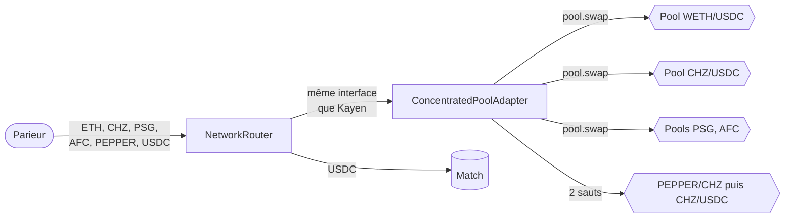
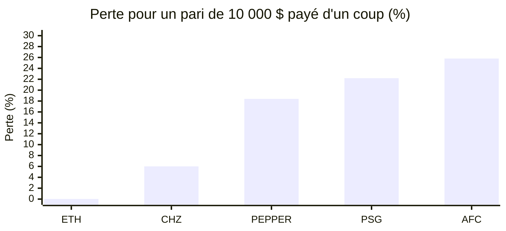
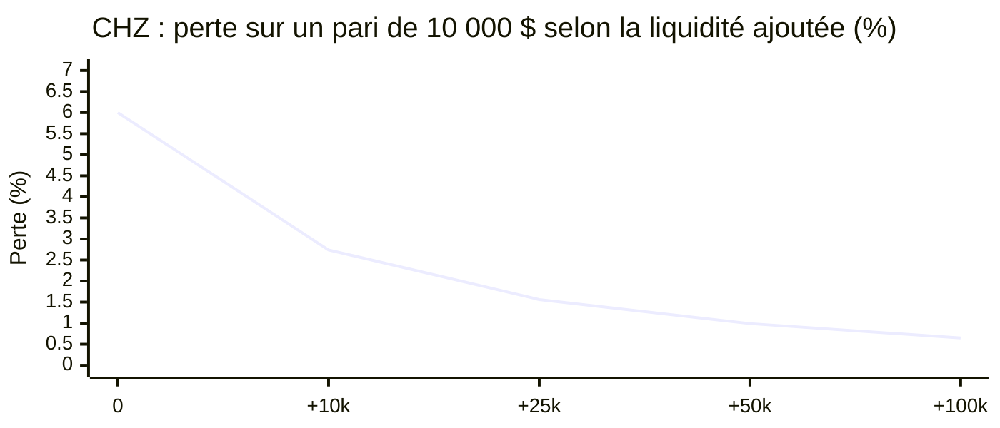

# Base : état et plan

> Ce qui change sur Base, les pools d'échange Aero, l'étude de liquidité et les étapes avant le mainnet. Sujet traité après Chiliz.

## Statut

| Élément | État au 11/11/2026 |
|---|---|
| Code | Dans la [PR #43](https://github.com/PredCast/predcast.tv/pull/43), le même que Chiliz |
| Tests | 18 tests sur un fork du mainnet Base, tous verts |
| Répétitions | Déploiement complet et test de paris et de streaming réussis sur des forks de Base Sepolia et du mainnet Base |
| Base Sepolia | Clés de test générées, en attente d'ETH de test pour déployer |
| Base mainnet | Rien de déployé. Checklist prête : `docs/BASE_MAINNET_CHECKLIST.md` |
| Pools d'échange | **Décision du 11/11/2026 : on garde les pools Aero** |

## Ce qui change par rapport à Chiliz

Les matchs, le leaderboard, le streaming et toutes les fonctions sont identiques. Seul le paiement d'entrée diffère.

| | Chiliz | Base |
|---|---|---|
| Token natif | CHZ | ETH |
| `router.wrappedNativeToken()` | WCHZ | WETH |
| Échange derrière le router | Kayen V2, appelé directement | `ConcentratedPoolAdapter` sur les pools Aero (Slipstream V3) |
| Tokens acceptés en paiement | Tout token qui a une pool contre WCHZ | Seulement ceux qui ont une route : WETH, CHZ, PSG, AFC, PEPPER |
| Décimales des fan tokens | 0 | 18 |
| Wrapping des fan tokens | Oui | Non |
| Ajouter un token | Rien à faire si une pool WCHZ existe | Le propriétaire appelle `adapter.setRoute` |
| Transactions | Legacy, gas autour de 2 500 gwei | EIP-1559, coût très faible |

L'adaptateur présente au router la même interface que Kayen. Le router n'a donc pas de version spéciale pour Base. Il appelle directement les pools, et n'accepte le rappel de paiement que de la pool qu'il est en train d'utiliser.

## Les pools Aero

Aerodrome (Base) et Velodrome (Optimism) ont fusionné le 21 octobre 2026 pour former **Aero**. Les deux sont développés par **Dromos Labs**. Aero introduit les pools **Slipstream V3**, avec des frais dynamiques.

Les pools utilisées par nos contrats viennent de la factory Slipstream V3 d'Aero, étiquetée « Dromos: CL Factory » sur Basescan :

`0x9CB220581b91b0C83223012FE69688b92aD07a76`

Elle n'apparaît pas dans le registre de l'ancien Aerodrome, ce qui explique qu'on ne voie pas ces pools sur l'ancien site. La liquidité y a migré : sur les fan tokens, les anciennes pools Aerodrome sont presque vides.

| Paire | Pool utilisée | Valeur totale (11/11/2026) | Meilleure ancienne pool Aerodrome |
|---|---|---|---|
| WETH/USDC | `0x4A7af46bC8aBc00048c6c7920a1488DAF568366c` | ≈ 10 M$ | ≈ 500 000 $ côté USDC |
| CHZ/USDC | `0xF97dc64314813De750169Ce924C92564bc9fF411` | ≈ 200 000 $ | ≈ 1 300 $ côté USDC |
| PSG/USDC | `0xce9d679f6451EC5B6B9ECbE49A59e59Ce24bbe2B` | ≈ 41 000 $ | ≈ 120 $ côté USDC |
| AFC/USDC | `0x3B62856717d896b0fdBF72CacD0184e5091e5740` | ≈ 42 000 $ | ≈ 170 $ côté USDC |
| PEPPER/CHZ | `0x125B160e0De44156F48f61990FAcf14A5328B972` | ≈ 58 000 $ | Pratiquement vide |

Les adresses sont dans `script/config/BaseDexConfig.sol`. Une pool se remplace sans redéployer, avec `adapter.setRoute`.

> **Reste à faire avant le mainnet :** retrouver l'adresse de cette factory dans la documentation officielle d'Aero (liste des contrats déployés). Tous les indices concordent, mais la doc officielle est la seule confirmation.

## L'étude de liquidité

Simulation du 11/11/2026 sur un fork du mainnet Base (bloc 55 884 092). Les échanges passent dans les mêmes pools et de la même façon que nos contrats. La perte est l'écart entre la valeur apportée au prix du marché et les USDC réellement misés.

| Payé en | 1 pari de 100 $ | 1 pari de 1 000 $ | 1 pari de 10 000 $ | 100 paris de 100 $ d'affilée : perte totale | dont le 100e parieur |
|---|---|---|---|---|---|
| **ETH** | 0,02 % | 0,02 % | 0,02 % | **2 $** | 0,02 % |
| **CHZ** | 0,27 % | 0,41 % | 6,0 % | **613 $** | 12,3 % |
| PSG | 0,78 % | 2,4 % | 22 % | 2 221 $ | 43 % |
| AFC | 0,65 % | 1,2 % | 26 % | 2 578 $ | 52 % |
| PEPPER | 0,79 % | 2,8 % | 18 % | 1 846 $ | 32 % |

**Comment lire ces chiffres**

- **Une partie de la perte, ce sont les frais de la pool**, versés aux fournisseurs de liquidité : environ 0,02 % sur ETH, 0,25 % sur CHZ, 0,6 % sur PSG et AFC. Le reste est l'impact sur le prix, récupéré par les arbitragistes qui remettent le prix d'aplomb.
- **C'est le parieur qui perd, pas PredCast.** Le contrat enregistre les USDC reçus : sur 10 000 $ payés en CHZ, la mise enregistrée est d'environ 9 400 USDC.
- **Paris étalés dans le temps.** Si des arbitragistes remettent le prix d'aplomb entre deux paris, chaque pari coûte la colonne « 100 $ ». Les 10 000 $ en CHZ coûtent alors environ 27 $ au total.
- **Paris concentrés.** Juste avant un coup d'envoi, le cas « d'affilée » est réaliste : 6 % sur CHZ, 18 à 26 % sur les fan tokens.
- **Trop gros pour la pool.** Un pari de 25 000 $ en AFC épuise la pool. L'adaptateur le refuse (`PartialFill`) plutôt que de l'exécuter à moitié.

### Remplir la pool CHZ/USDC

Simulation d'un ajout de liquidité concentrée dans une plage de ±5 % autour du prix :

| Liquidité ajoutée | Pari de 1 000 $ | Pari de 5 000 $ | Pari de 10 000 $ |
|---|---|---|---|
| Aucune (aujourd'hui) | 0,39 % | 2,80 % | 6,00 % |
| + 10 000 $ | 0,34 % | 1,32 % | 2,74 % |
| + 25 000 $ | 0,32 % | 0,83 % | 1,56 % |
| + 50 000 $ | 0,30 % | 0,58 % | 0,99 % |
| + 100 000 $ | 0,28 % | 0,43 % | 0,65 % |

- Environ **50 000 $ sur ±5 %** font passer un pari de 10 000 $ sous 1 % de perte. Sur une plage de ±10 %, il en faut environ le double.
- On ne descend jamais sous les frais de la pool, 0,25 %.
- Une plage étroite doit être déplacée quand le prix du CHZ en sort, et elle expose à une perte par rapport à simplement garder les tokens. En échange, elle touche 0,25 % de tout le volume qui passe.
- C'est une décision de trésorerie, pas de code. Aero propose aussi un système d'incitations pour attirer des fournisseurs de liquidité sur une pool.

## Recommandations pour le produit

1. **ETH et USDC par défaut.** USDC ne coûte rien, ETH 0,02 %.
2. **Calculer `amountOutMin` à partir du prix de marché** du token (une source externe), moins 1 % par exemple. Le contrat refusera alors de lui-même tout pari qui ferait perdre plus. Aucun changement de contrat n'est nécessaire.
3. **Afficher la mise réelle** (« vous misez 93,88 USDC ») avant validation pour CHZ et les fan tokens, avec un avertissement au-delà de 1 %.
4. **Plafonner dans l'interface** la taille d'un paiement en fan token, ou ne pas proposer ces tokens au-delà d'un montant.

## Avant le mainnet

| # | Étape | Détail |
|---|---|---|
| 1 | Financer les clés Sepolia | Faucet Base Sepolia vers le déployeur (≈ 0,03 ETH), le propriétaire (≈ 0,01) et l'oracle (≈ 0,005) |
| 2 | Déployer sur Sepolia | `./deploy.sh --network baseSepolia --all --dry-run`, puis sans `--dry-run` |
| 3 | Tester sur Sepolia | `script/SmokeTestBase.s.sol` : paris, résolution, réclamation, streaming, avec vérification de chaque montant |
| 4 | Confirmer la factory Aero | Dans la documentation officielle d'Aero |
| 5 | Créer le Safe sur Base | Un Safe d'un autre réseau n'existe pas sur Base. `DeployAll` refuse une adresse sans code |
| 6 | Clés neuves | Déployeur, opérateur et oracle dédiés au mainnet |
| 7 | Audit externe | Avant des montants importants |
| 8 | Déployer sur le mainnet | Par une personne qui détient les clés, en suivant `docs/BASE_MAINNET_CHECKLIST.md` |
| 9 | Premiers paris en petits montants | Faits à la main, puis mise à jour du frontend et du backend |

Adresses de test Base Sepolia, à financer (clés générées localement, jamais versionnées) :

| Rôle | Adresse |
|---|---|
| Déployeur et opérateur | `0x77ec62E83a49236a387C9072214345b2F16caff8` |
| Propriétaire, streamer de test | `0x5fee646D386De374f38396BC28c4127a0A17E0BC` |
| Oracle | `0xbaFFFB1231d297c20944E992117A5035489Bc07C` |

> **Note pour les développeurs.** Les tests de fork du mainnet Base et le smoke test ont besoin de `--evm-version cancun --out out-cancun --cache-path cache-cancun`. Les pools Aero utilisent des opcodes Cancun dans leur hook de frais. La configuration du projet reste en `shanghai` pour Chiliz.
